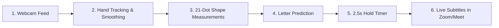

# 🤟 Real-Time Indian Sign Language (ISL) Detector & Virtual Camera
## 📖 Simple Master Preparation & Interview Guide

This guide is designed to be **simple, practical, and easy to explain**. There are **no complex mathematical formulas** here—just clear explanations of how the project works, why it was built this way, and how to talk about it in interviews, project presentations, and demos.

---

# 📌 1. Project Summary: What is this project?

* **In One Sentence**: It is a real-time tool that reads Indian Sign Language (ISL) hand gestures through your regular laptop webcam, turns them into live text and words, and displays them as subtitles right inside your Zoom or Google Meet calls.
* **The Problem It Solves**:
  * Over 63 million people in India are deaf or hard-of-hearing, and Indian Sign Language is their main way of talking.
  * Very few hearing people know sign language, making video calls on Zoom, Teams, and Google Meet almost impossible without a costly human interpreter.
* **Why Our Approach is Better**:
  * Most existing AI tools need expensive graphics cards (GPUs) and slow down your laptop.
  * Our system is **ultra-lightweight**. It runs smoothly on any normal laptop CPU, uses almost no battery, and has zero noticeable lag.
  * It works for **both one-handed and two-handed signs**, which is essential for Indian Sign Language.
  * It stores clean **dot patterns** for each letter and is built to be easily expanded for **numbers (0 to 9)** in the future.

---

# 🔄 2. The 4 Core Pillars of This Pipeline

### 🌟 Pillar 1: Training & Alphabet/Number Dot Patterns
* During training, the system locates the hand skeleton and saves a clean **dot pattern** for every letter into a database (`data/patterns_database.json`).
* It maps the standard 21 joint points (wrist, knuckles, fingertips) for each character.
* **Future-Proof & Expandable**: The loader automatically scans any folder in `dataset_ISL/`. If you add folders for numbers (`0` to `9`) or custom gestures tomorrow, the pipeline automatically processes and adds them with zero code changes!

### 🌟 Pillar 2: High Accuracy in Locating Hand Points
* MediaPipe locates the 21 key points on your hand in 3D space.
* To make tracking rock-solid, we added **temporal smoothing**:
  * If the camera has slight micro-shakes, the system smooths the points between consecutive frames so the dots stay steady on your fingers without jumping around.
  * It automatically ignores room background, wall posters, clothing colors, and skin tones.

### 🌟 Pillar 3: Validating Coordinates to Stop Confusion Between Characters
* Some sign language letters look very similar (for example, 'H' vs 'W', or 'C' vs 'O').
* We added an automated **Coordinate Validation Engine** (`src/train_model.py`):
  * It measures the separation distance between every pair of characters.
  * It generates a validation report (`data/coordinate_validation_report.json`) to ensure that every letter has a distinct, unmistakable dot pattern before the model is trained.
  * During live video, if two letters are too close to call, it displays an on-screen warning (like `"C? (O)"`) instead of guessing wrong.

### 🌟 Pillar 4: The 2 to 3 Second Hold Timer for Live Captions
* Unlike clumsy systems that type accidental letters whenever your hand moves, our system uses a **2 to 3 second hold-to-type timer** (default: 2.5 seconds):
  * When you make a sign, a live **Hold Progress Bar** appears right above your hand and in the subtitle bar: `Holding 'A' [======------] 1.8s / 2.5s (72%)`.
  * You must hold the sign steady for the full duration before the letter locks into your sentence.
  * When you lower your hand for 2.5 seconds, the system automatically inserts a space between words!

---

# 🔄 3. How It Works Step-by-Step (The Pipeline)

1. **Webcam Capture**: Reads video at 30 frames per second using the Windows DirectShow driver for instant response with zero delay.
2. **Hand Skeleton Tracking (MediaPipe)**: Finds the 21 hand points and smooths them to eliminate jitter.
3. **Distance-Proofing (Normalization)**: Centers on the wrist and scales by hand size so you can sit close or far from the camera.
4. **Measuring Finger Shapes**: Checks if fingers are straight, curled, touching, or spread apart, plus the distance between both hands for two-handed signs.
5. **Random Forest Classifier**: 200 fast decision trees vote on the finger shapes and predict the character in less than half a millisecond.
6. **2.5-Second Hold-to-Type**: You hold the sign steady; a progress bar fills up, and the character locks in.
7. **Virtual Camera Output**: Subtitles appear at the bottom of the video, streaming into Zoom or Google Meet as a virtual webcam.

---

# 🛠️ 4. Technologies Used & Why We Chose Them

| Technology | What it is | Why we used it |
| :--- | :--- | :--- |
| **Python** | The programming language. | Clean, fast to prototype, with great vision and machine learning support. |
| **OpenCV** | Video processing library. | Reads the webcam feed fast and draws the subtitle box and progress bar. |
| **MediaPipe** | Hand tracking AI from Google. | Finds 21 hand joints in milliseconds. Runs on cheap CPUs without needing a GPU. |
| **Scikit-Learn (Random Forest)** | Machine learning library. | Fast, highly accurate classifier that predicts letters in less than 1 millisecond. |
| **NumPy & Pandas** | Data tools. | Organizes the joint coordinates, builds patterns, and handles datasets. |
| **PyVirtualCam** | Virtual webcam software tool. | Broadcasts our captioned video directly into Zoom, Google Meet, or Teams. |

---

# ❓ 5. Top 8 Interview Questions & Simple Answers

### Q1: Can you give a 30-second summary of your project?
* **Answer**: "I built a real-time Indian Sign Language translator that runs on any regular laptop without a GPU. It uses Google MediaPipe to track 21 hand joints with temporal smoothing, checks finger shape patterns, and classifies characters using a Random Forest model. It uses a 2 to 3 second hold-to-type timer to prevent typos and streams live subtitles directly into Zoom or Google Meet as a virtual webcam."

### Q2: How does the system store patterns, and can it handle numbers (0–9)?
* **Answer**: "During preprocessing, the system computes the canonical 21-dot pattern for each character and saves it into a JSON database (`patterns_database.json`). The loader dynamically reads any folder in the dataset, so adding numerical signs (0 to 9) or custom symbols is as simple as adding a folder—the pipeline processes them automatically."

### Q3: How do you ensure high accuracy in locating the hand points?
* **Answer**: "We use MediaPipe HandLandmarker with a 0.55 confidence threshold and added exponential moving average smoothing between consecutive frames. This prevents point jitter when the user's hand shakes slightly. We also use wrist-centering and size normalization so the points are accurate whether the user is close to or far from the webcam."

### Q4: How do you validate coordinate data so the model doesn't confuse similar characters?
* **Answer**: "We built an automated Coordinate Validation Engine. It calculates the centroid of dot patterns for each character and measures the separation distance between every pair. It flags any close pairs (like 'H' and 'W') in a validation report (`coordinate_validation_report.json`). During live inference, if a sign falls in an ambiguous zone between two letters, the system warns the user instead of guessing wrong."

### Q5: Why did you add a 2 to 3 second hold timer before generating captions?
* **Answer**: "In real-time sign language, moving your hands into position creates temporary in-between shapes that can trigger accidental letters. By requiring the user to hold the sign for 2 to 3 seconds, we ensure deliberate typing. We also draw a live progress bar on the screen so the user knows exactly when the letter will lock in."

### Q6: How does the Virtual Camera work with Zoom and Google Meet?
* **Answer**: "We use PyVirtualCam to broadcast our video with the subtitle bar into an OS-level virtual camera. In Zoom or Google Meet, the user picks 'OBS Virtual Camera' as their webcam device. Everyone on the call sees the video with live subtitles with no extra software needed."

### Q7: How does the system know when to add a space between words?
* **Answer**: "When a user finishes spelling a word, they naturally drop their hands or pause. If no hand is detected for 2.5 seconds, the system automatically inserts a space between words and gets ready for the next word."

### Q8: What are the keyboard shortcuts for editing?
* **Answer**: "Press 'b' to backspace (delete a letter), 'c' to clear the entire line, and 'q' to quit."

---

# 🎙️ 6. Presentation Script (Spoken English, Easy to Present)

> **[Opening - 30 seconds]**
> *"Hello everyone. In India, over 63 million people are deaf or hard-of-hearing. Indian Sign Language is their primary language, but almost nobody in the hearing world understands it. In our world of remote work and online meetings on Zoom and Google Meet, deaf individuals face a severe communication barrier.*
> 
> *I wanted to build a practical, zero-cost, real-time solution that runs on any regular laptop without needing an expensive gaming computer.*
> 
> **[How It Works - 1 minute]**
> *My pipeline is built around four key principles:*
> *First, it captures the hand skeleton using Google MediaPipe and saves canonical dot patterns for every character into an expandable database that supports both letters and numbers.*
> *Second, it uses temporal smoothing to keep hand point locations rock-solid and stable on the screen.*
> *Third, it validates coordinate data before training to ensure every character has a distinct, clear pattern that never confuses the model.*
> *Fourth, to prevent accidental typing while moving hands, it uses a 2.5-second hold-to-type timer with a live visual progress bar on screen. Lowering your hands for 2.5 seconds automatically adds a space.*
> 
> **[Live Demo & Impact - 30 seconds]**
> *Best of all, using PyVirtualCam, the live subtitles stream directly into Zoom or Google Meet. When I make a sign, words type out on my video tile for everyone on the call to read with zero lag.*
> 
> *It runs smoothly at 35 frames per second on a standard CPU. Thank you, and I am excited to demonstrate it live!"*

---

# 📁 7. Quick Code Map: What each file does

* **`main.py`**: The starting point of the project. Supports `--hold-time` (default 2.5s) and `--virtual-cam`.
* **`src/realtime_inference.py`**: The live video loop: captures camera, runs smoothed hand detection, connects to hold timer, and manages hotkeys.
* **`src/caption_overlay.py`**: Manages the 2-3s hold timer, auto-space silence detection, and draws the live progress bar and subtitle HUD.
* **`src/landmark_extractor.py`**: Tracks 21 hand points with EMA smoothing and calculates finger shape measurements.
* **`src/data_preprocessing.py`**: Extracts training data, computes canonical dot patterns, and saves `data/patterns_database.json`.
* **`src/train_model.py`**: Validates coordinate separability, generates `data/coordinate_validation_report.json`, and trains the Random Forest model.
* **`src/virtual_cam_output.py`**: Streams captioned video frames to the virtual camera for Zoom and Google Meet.
